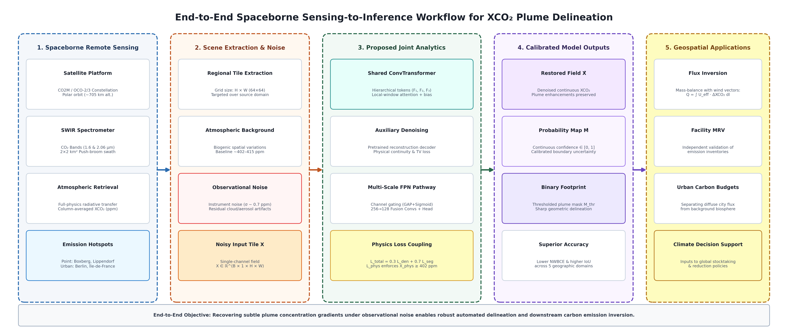
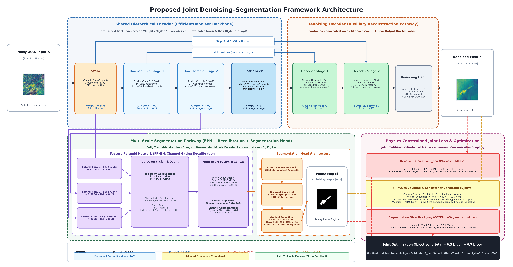
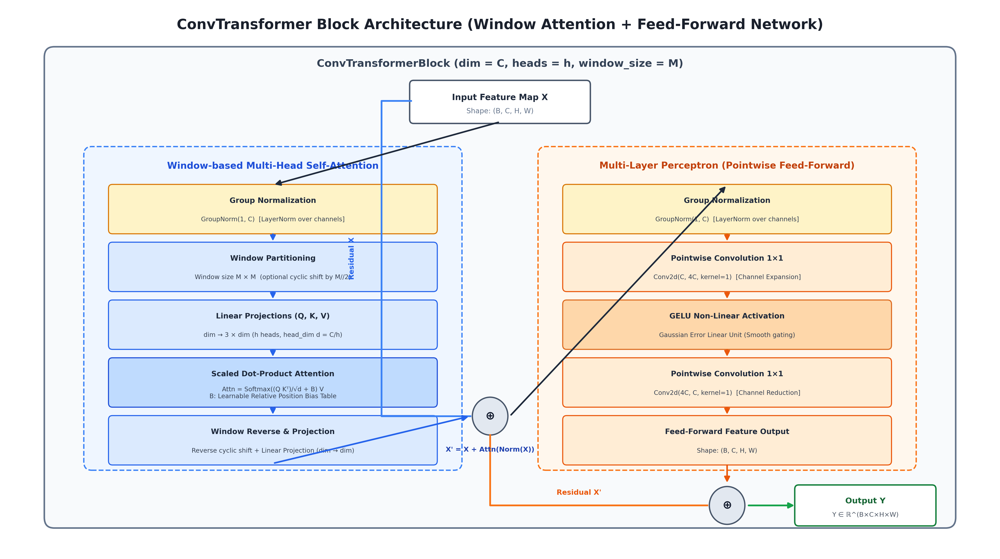
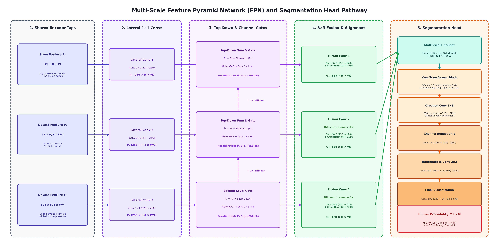
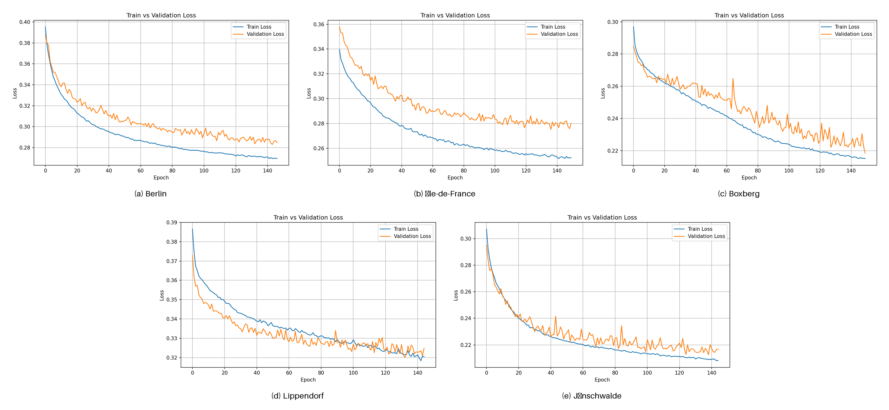
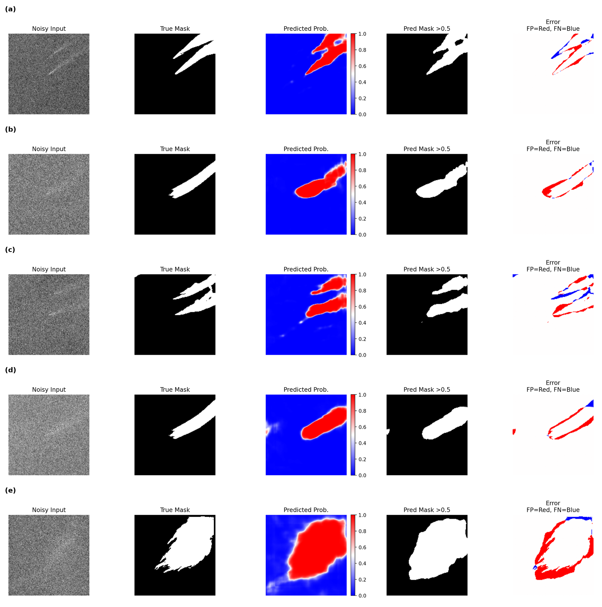

# Restoration-Aware Joint Learning for Robust CO₂ Plume Segmentation from Noisy XCO₂ Observations

[](https://www.python.org/)
[](https://pytorch.org/)
[](LICENSE)
[](https://www.sciencedirect.com/journal/computers-and-geosciences)

> **Official PyTorch Implementation** for the manuscript:  
> **"Restoration-Aware Joint Learning for Robust CO₂ Plume Segmentation from Noisy XCO₂ Observations"**  
> *Computers & Geosciences (Elsevier)*  
> Authors: Anil Verma, Rupesh Kumar Sah, Rajiv Misra, Trilok Nath Singh (*Indian Institute of Technology Patna*)

---

## 🛰️ Overview

Automated monitoring of localized anthropogenic carbon dioxide ($\text{CO}_2$) plumes from satellite imagery is critical for global greenhouse gas accounting and independent emission verification. However, pixel-level plume delineation in spaceborne soundings (e.g., Copernicus $\text{CO}_2\text{M}$, $\text{OCO}$-2/3) is severely challenged by:
1. **Low Signal-to-Noise Ratio (SNR):** Instrument single-sounding noise ($\sigma \sim 0.5\text{--}0.7\,\text{ppm}$) is comparable in magnitude to weak plume extensions ($\Delta\text{XCO}_2 \sim 1\text{--}3\,\text{ppm}$).
2. **Atmospheric Background Interference:** Naturally fluctuating background concentrations ($\sim 402\text{--}420\,\text{ppm}$) obscure diffuse plume perimeters.
3. **Representation Degeneracy in Standard Semantic Segmentation:** Direct semantic segmentation models (such as standalone U-Net) optimize only binary boundaries and discard continuous concentration gradients.

To overcome these limitations, this framework introduces **segmentation-oriented joint learning with auxiliary $\text{XCO}_2$ restoration**. By coupling continuous concentration reconstruction and discrete plume footprint segmentation through a **shared hierarchical ConvTransformer backbone**, the shared feature space is regularized to retain subtle, physically coherent concentration structures while suppressing high-frequency spectrometer noise.

---

## 🌟 Key Research Highlights

* **Auxiliary Restoration Supervision:** Employs continuous $\text{XCO}_2$ concentration reconstruction as an auxiliary objective, improving representation learning under noisy sensing conditions.
* **Shared Hierarchical ConvTransformer Backbone:** Features local window-based multi-head self-attention with learnable relative position bias, scaling linearly with image resolution while capturing long-range plume dispersion geometry.
* **Multi-Scale Feature Pyramid & Recalibration:** Reuses multi-scale encoder representations ($F_1, F_2, F_3$) via recursive top-down bilinear fusion and adaptive channel-wise recalibration gating.
* **Restricted Backbone Adaptation Protocol:** Preserves low-level spatial filtering primitives by freezing core encoder kernels ($\nabla=0$) while adapting normalization affine layers and bias vectors ($\nabla \ne 0$) alongside trainable segmentation modules.
* **Physics-Informed Joint Objective:** Combines continuous reconstruction loss ($\text{MSE} + \text{SSIM} + \text{TV} + \text{Mass}$) with boundary-aware Focal Tversky loss, mask smoothness regularization, and an atmospheric background physics consistency constraint.
* **Consistent Cross-Regional Gains:** Evaluated across 5 diverse geographic emission scenarios (Berlin, Île-de-France, Boxberg, Lippendorf, Jänschwalde):
  * **24.6% reduction in Mean NWBCE** (decreased from $0.480 \pm 0.061$ to $0.362 \pm 0.053$).
  * **24.1% improvement in Mean IoU** (increased from $0.614 \pm 0.070$ to $0.762 \pm 0.055$).
  * **20.6% relative error reduction** over the unassisted baseline in controlled ablation ($0.456 \rightarrow 0.362$).

---

## 🖼️ Visual Gallery & Architectural Framework

### Figure 1: End-to-End Spaceborne Sensing-to-Inference Workflow
From spectroscopic SWIR absorption soundings to regional observation tile extraction, joint restoration-aware deep neural inference, calibrated dual outputs, and downstream carbon flux inversion.


### Figure 2: Proposed Joint Denoising–Segmentation Architecture
The overall framework coupling continuous restoration (upper decoder branch) and multi-scale plume segmentation (lower FPN branch) through a shared three-stage ConvTransformer encoder.


### Figure 3: ConvTransformer Block Architecture
Local window-based multi-head self-attention with learnable relative position bias, cyclic shifting, Group Normalization, and pointwise MLP with GELU non-linearity.


### Figure 4: Multi-Scale Feature Pyramid Segmentation Pathway
Hierarchical encoder features ($F_1, F_2, F_3$) projected to unified 256 channels, recursively fused top-down, recalibrated via channel gating, aligned spatially, and processed by the segmentation head.


### Figure 5: Training and Validation Convergence Across Geographic Scenarios
Convergence behavior of joint multi-task loss components across all five evaluated European geographic regions.


### Figure 6: Qualitative Qualitative Segmentation Delineation
Representative plume segmentation predictions and pixel-level error maps across megacity and industrial point-source scenarios.


---

## 📐 Mathematical Formulation

### 1. Dual Network Mapping
$$(\hat{\mathbf{X}}, \hat{\mathbf{M}}) = f_{\theta}(\mathbf{X})$$
where $\mathbf{X} \in \mathbb{R}^{B \times 1 \times H \times W}$ is the input noisy $\text{XCO}_2$ tile, $\hat{\mathbf{X}}$ is the restored continuous concentration field, and $\hat{\mathbf{M}} \in [0, 1]$ is the calibrated plume probability map.

### 2. Multi-Task Joint Loss
$$\mathcal{L}_{\text{total}} = 0.3\,\mathcal{L}_{\text{den}} + 0.7\,\mathcal{L}_{\text{seg}}$$

#### Denoising Objective ($\mathcal{L}_{\text{den}}$):
$$\mathcal{L}_{\text{den}} = 0.8\,\mathcal{L}_{\text{MSE}} + 0.2\,(1 - \text{SSIM}) + 0.05\,\mathcal{L}_{\text{TV}} + 0.1\,\mathcal{L}_{\text{mass}}$$
* **$\mathcal{L}_{\text{MSE}}$**: Pixel-wise reconstruction error against clean reference concentration.
* **$\text{SSIM}$**: Structural similarity index evaluated with dynamic range parameter $D = 6.0\,\text{ppm}$.
* **$\mathcal{L}_{\text{TV}}$**: Continuous total variation regularizer penalizing high-frequency striping artifacts.
* **$\mathcal{L}_{\text{mass}}$**: Enforces physical mass conservation over the active plume footprint.

#### Segmentation Objective ($\mathcal{L}_{\text{seg}}$):
$$\mathcal{L}_{\text{seg}} = \mathcal{L}_{\text{FT}} + 0.5\,\mathcal{L}_{\text{phys}} + 0.1\,\mathcal{L}_{\text{TV-mask}}$$
* **Boundary-Aware Focal Tversky Loss ($\mathcal{L}_{\text{FT}}$)**: Employs a $5 \times 5$ morphological dilation-erosion band ($w_b = 3.0$) with parameters $\alpha=0.8$ and focal exponent $\gamma=2.0$ to focus gradient updates on uncertain plume boundaries.
* **Atmospheric Background Physics Penalty ($\mathcal{L}_{\text{phys}}$)**: Penalizes predicted plume pixels ($p_{i,j} > 0.5$) whose reconstructed concentration falls below ambient regional background ($c_{\text{thresh}} = 402.0\,\text{ppm}$):
  $$v_{i,j} = \min\left(15.0, \max\left(0, c_{\text{thresh}} - X_{\text{phys}, i, j}\right) \cdot \mathbb{I}(p_{i,j} > 0.5)\right)$$
  $$\mathcal{L}_{\text{phys}} = \frac{1}{HW}\sum_{i,j} \log(1 + v_{i,j}) \cdot \exp\left(\frac{v_{i,j}}{T_{\text{temp}}}\right), \quad T_{\text{temp}} = 8.0$$
* **Mask Smoothness Regularization ($\mathcal{L}_{\text{TV-mask}}$)**: Minimizes squared spatial gradients of predicted probabilities to eliminate isolated pixel false alarms.

---

## 📂 Repository Structure

```text
XCO2-Plume-Joint-Learning/
├── assets/
│   ├── figures/               # 300 DPI publication figures (Figure 1 to 6)
│   ├── diagrams/              # Fully editable Draw.io vector source diagrams
│   └── samples/               # Sample observation patches and regional loss curves
├── docs/
│   ├── ARCHITECTURE.md        # Detailed mathematical derivations & layer specifications
│   └── DATASET.md             # ESA SMARTCARB dataset guide, noise model & split protocols
├── models/
│   ├── __init__.py            # Model package interface
│   ├── denoiser.py            # WindowAttention, ConvTransformerBlock & EfficientDenoiser
│   ├── fpn.py                 # Multi-scale FeaturePyramid & SegmentationHead
│   ├── joint_model.py         # JointDenoiseSeg framework with restricted adaptation
│   └── losses.py              # PhysicsSSIMLoss, CO2PlumeSegmentationLoss & JointPhysicsLoss
├── scripts/
│   ├── __init__.py
│   ├── create_drawio.py       # Programmatic Draw.io XML vector diagram generator
│   ├── generate_all_figures.py# Complete publication artwork rendering pipeline
│   └── render_architecture_figure.py # Matplotlib architecture renderer
├── .gitignore                 # Standard Python, PyTorch & OS ignore rules
├── CITATION.cff               # GitHub citation metadata
├── LICENSE                    # MIT License
├── README.md                  # Comprehensive documentation and project guide
├── combi_seg_den.py           # Top-level backward compatibility module
├── demo_inference.py          # Standalone verification and quickstart demo script
├── denoise_model2.py          # Standalone denoiser reference module
├── environment.yml            # Conda environment specification
├── physics_losses.py          # Top-level loss backward compatibility module
└── requirements.txt           # Python package dependencies
```

---

## ⚡ Quickstart & Installation

### Option 1: Conda Environment (Recommended)

```bash
# Clone the repository
git clone https://github.com/Agnad/CO2_Plume_Segmentation.git
cd CO2_Plume_Segmentation

# Create and activate conda environment
conda env create -f environment.yml
conda activate xco2-joint-learning
```

### Option 2: Python Virtual Environment & Pip

```bash
# Create and activate virtual environment
python -m venv venv
# On Linux/macOS:
source venv/bin/activate
# On Windows:
.\venv\Scripts\activate

# Install dependencies
pip install -r requirements.txt
```

---

## 🚀 Running the Verification Demo

Run the self-contained verification pipeline to validate model instantiation, synthetic observation synthesis, forward inference, and joint loss calculation:

```bash
python demo_inference.py
```

### Example Console Output:
```text
===========================================================================
  Restoration-Aware Joint Learning for Satellite XCO2 Plume Monitoring
  Verification & Quickstart Inference Pipeline
===========================================================================
Target Device:     cuda (NVIDIA RTX 4090)
Input Shape:       Batch=2, Channels=1, Height=160, Width=160

[1/4] Instantiating JointDenoiseSeg model...
      Initialized in 0.38s
      Total Parameters:     6,184,834
      Trainable Parameters: 3,425,154 (55.38%)
      Frozen Parameters:    2,759,680 (Pretrained denoiser backbone)

[2/4] Generating synthetic XCO2 observation tiles...
      Noisy observation tile min/max: -1.82 / 3.45
      Plume foreground pixels:        1248 / 51200

[3/4] Running forward inference pass...
      Forward pass completed in 42.1 ms
      Denoised field output: shape=(2, 1, 160, 160), dtype=torch.float32
      Plume probability map: shape=(2, 1, 160, 160), min=0.0001, max=0.9842
      Shape and output boundary assertions verified.

[4/4] Evaluating Joint Physics-Informed Multi-Task Loss...
      Total Joint Loss:      0.24812 (0.3 * Denoise + 0.7 * Seg)
      Denoise Loss Component:0.18420 (MSE + SSIM + TV + Mass)
      Seg Loss Component:    0.27551 (Focal Tversky + Physics + TV)

===========================================================================
  All verification stages completed successfully!
===========================================================================
```

---

## 💻 Python API Usage

### 1. Model Instantiation & Forward Pass

```python
import torch
from models import JointDenoiseSeg

# Initialize joint model (with optional pretrained denoiser checkpoint)
model = JointDenoiseSeg(weights_path=None, freeze_backbone=True)
model.eval()

# Synthetic noisy satellite observation (B, 1, H, W)
# Height and width must be divisible by 4
noisy_xco2 = torch.randn(4, 1, 160, 160)

with torch.no_grad():
    # Returns restored continuous XCO2 field and plume probability map
    denoised_xco2, plume_probability = model(noisy_xco2)

print(f"Restored continuous XCO2: {denoised_xco2.shape}")      # (4, 1, 160, 160)
print(f"Plume probability map:    {plume_probability.shape}")  # (4, 1, 160, 160)
```

### 2. Multi-Task Joint Loss Calculation

```python
import torch
from models import JointPhysicsLoss

# Initialize composite joint criterion
criterion = JointPhysicsLoss(denoise_weight=0.3, seg_weight=0.7)

# Compute loss against ground-truth clean concentration and reference mask
losses = criterion(
    denoised=denoised_xco2,
    seg_pred=plume_probability,
    clean=clean_target_xco2,
    mask=ground_truth_mask
)

print(f"Total Loss:   {losses['total'].item():.4f}")
print(f"Denoise Loss: {losses['denoise'].item():.4f}")
print(f"Seg Loss:     {losses['seg'].item():.4f}")

# Backpropagation during training:
# losses['total'].backward()
```

---

## 📊 Dataset & Pretraining Protocol

Experiments are based on high-resolution ($1\,\text{km} \times 1\,\text{km}$) **COSMO-GHG** atmospheric transport simulations from the **ESA SMARTCARB archive**, resampled to $2\,\text{km} \times 2\,\text{km}$ single-sounding ground footprints for the Copernicus Anthropogenic $\text{CO}_2$ Monitoring ($\text{CO}_2\text{M}$) mission.

* **Noise Synthesis:** Perturbed with pseudo-random Gaussian noise $\epsilon \sim \mathcal{N}(0, \sigma^2)$ with $\sigma \in [0.5, 0.7]\,\text{ppm}$.
* **Data Partitioning:** All evaluation scenes, dates, and geographic regions (Berlin, Île-de-France, Boxberg, Lippendorf, Jänschwalde) were strictly excluded from the pretraining phase to prevent data leakage.
* For complete details on dataset characteristics, access links, and processing scripts, see [docs/DATASET.md](docs/DATASET.md).

---

## 🎨 Regenerating Publication Figures

All manuscript figures and editable vector diagrams can be regenerated programmatically:

```bash
# Generate all Figures 1-6 and Draw.io XML files
python scripts/generate_all_figures.py

# Render the high-resolution architecture figure
python scripts/render_architecture_figure.py
```

---

## 📝 Citation

If you find this codebase or architecture helpful in your research, please cite our article:

```bibtex
@article{verma2026restoration,
  title     = {Restoration-Aware Joint Learning for Robust {$\mathrm{CO}_2$} Plume Segmentation from Noisy {$\mathrm{XCO}_2$} Observations},
  author    = {Verma, Anil and Sah, Rupesh Kumar and Misra, Rajiv and Singh, Trilok Nath},
  journal   = {Computers \& Geosciences},
  year      = {2026},
  publisher = {Elsevier},
  note      = {In review}
}
```

---

## 📜 License

This project is licensed under the [MIT License](LICENSE) - see the LICENSE file for details.

---

## 📬 Contact & Inquiries

For technical questions or academic collaboration:
* **Anil Verma** (Corresponding Author): `anil_2321cs11@iitp.ac.in`  
* **Rupesh Kumar Sah**: `rupesh_2421cs03@iitp.ac.in`  
Department of Computer Science and Engineering, Indian Institute of Technology Patna, Bihta, Bihar 801106, India.
